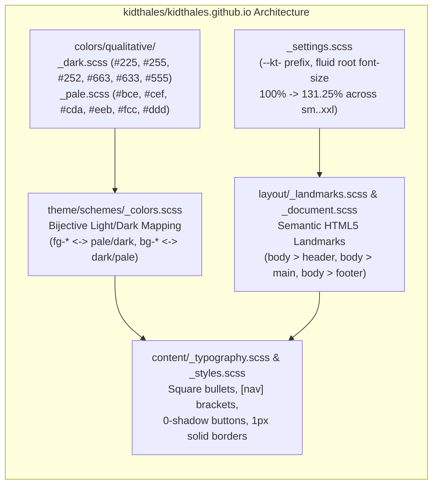

# Portal Visual Identity, Minimalist Architecture & Paul Tol Color Science Audit

> **Status:** Design & Architectural Proposal (Awaiting Creative Director Review)  
> **Repository:** [`agogpixel/agogpixel.github.io`](https://github.com/agogpixel/agogpixel.github.io)  
> **Issue:** [#14 — `docs(design): audit portal visual identity against AI-template tropes, kidthales.com minimalism & Paul Tol color science`](https://github.com/agogpixel/agogpixel.github.io/issues/14)  
> **Date:** 2026-10-14  
> **Authors:** Antigravity & kidthales  
> **Reference Implementations:**
> - [`kidthales/kidthales.github.io`](https://github.com/kidthales/kidthales.github.io) ([kidthales.com](https://kidthales.com/))
> - [Paul Tol's Notes on Colour Schemes and Templates (SRON)](https://sronpersonalpages.nl/~pault/)
> - [Agogpixel Brand Identity & Mascot Guide](https://github.com/agogpixel/agogpixel-studio/blob/main/docs/branding/brand_identity_and_mascot_guide.md)

---

## Executive Summary

While the Phase 1 scaffolding of `agogpixel.github.io` delivers a fast, zero-JS Astro v5 + Tailwind CSS static pipeline with valid Content Collections and RSS syndication, its current visual presentation relies heavily on recognizable **"AI-generated dark-mode SaaS template" tropes**:
1. **Six simultaneous ambient radial glow layers** (`blur-[100px]`, `blur-[90px]`, `blur-[110px]`, `blur-2xl`, plus two fixed `body` radial gradients).
2. **Glowing status pills with pulsing telemetry dots** (`rounded-full border-brand-cyan/30 ... animate-pulse`) used for static studio mottos (*"An A- Studio"*, *"Building an A- Studio in Public"*).
3. **Glassmorphic sticky headers and neon-shadowed icon containers** (`backdrop-blur-md`, `shadow-brand-cyan/20`, `hover:scale-[1.02]`).
4. **Uncalibrated Tailwind `slate-*` utility leakage** (`text-slate-200` through `text-slate-600`, `prose-slate`), which injects a cool blue chromatic cast ($b^* \in [-12.6, -4.6]$) over the neutral `#030303` Cosmos Black canvas instead of using the studio's neutral ramp (**Starlight White** `#EEEEEE`, **Lunar Grey** `#A6A6A6`, **Hull Charcoal** `#4E4E4E`).
5. **Orphaned cyber-SaaS token bloat** in [`tailwind.config.mjs`](../../tailwind.config.mjs) (`cyber.purple: '#a855f7'`, duplicate `void.*` and `cyber.*` aliases).

Furthermore, a rigorous mathematical audit of the current 5-token studio palette against **Paul Tol's color science criteria** reveals a critical perceptual and color-vision deficiency (CVD) vulnerability:
- **Thruster Amber (`#C97320`) vs. Rocket Scarlet (`#E63946`) Luminance & Deuteranopia Collision**:
  - In CIE $L^*a^*b^*$ perceptual space, `#C97320` ($L^* = 56.9, Y = 0.2478$) and `#E63946` ($L^* = 52.1, Y = 0.2019$) are separated by only **$\Delta L^* = 4.8$** (a pairwise WCAG contrast ratio of just **$1.18:1$**), rendering them nearly identical in monochrome/greyscale vision.
  - Under **Paul Tol's green-blind (deuteranopia) sRGB simulation formula**, `#C97320` transforms to `#95952D` (`rgb(149, 149, 45)`) and `#E63946` transforms to `#8D8D47` (`rgb(141, 141, 71)`), collapsing into nearly indistinguishable murky olive tones ($\Delta E_{ab}^* = 16.7$).

This report deconstructs every AI-template trope in `agogpixel.github.io`, extracts the minimalist structural and semantic color patterns from [`kidthales/kidthales.github.io`](https://github.com/kidthales/kidthales.github.io), presents the complete mathematical color-science evaluation, and provides **three concrete palette/architecture options**, **component-by-component diffs**, and **copy-paste-ready updates** for the studio's master brand guide.

---

## 1. Forensic Audit of "AI Template" Tropes in `agogpixel.github.io`

An exhaustive line-by-line inspection of `src/` and `tailwind.config.mjs` identified **6 distinct categories of generic AI-template clichés** across 8 files.

### 1.1 Master Catalog of Visual Clichés by File & Line

| # | Trope Category | File & Line Range | Current Implementation Snippet | Why It Reads as an AI / SaaS Cliché |
| :-: | :--- | :--- | :--- | :--- |
| **T1** | **Fixed Ambient Body Radial Gradients** | [`src/styles/global.css:13-16`](../../src/styles/global.css#L13-L16) | `radial-gradient(ellipse 80% 50% at 50% -20%, rgba(76, 201, 240, 0.08), transparent), radial-gradient(ellipse 60% 40% at 100% 50%, rgba(201, 115, 32, 0.05), transparent)` | Directly lifts the Vercel/Linear v1 dark-mode SaaS landing page gradient formula, tinting `#030303` Cosmos Black into a muddy `#081115` haze at the top of every page. |
| **T2** | **Stacked Blurred Neon Orbs (`blur-[100px]`)** | [`src/pages/index.astro:12-15`](../../src/pages/index.astro#L12-L15)<br>[`src/pages/index.astro:20`](../../src/pages/index.astro#L20)<br>[`src/pages/devlogs/index.astro:26-28`](../../src/pages/devlogs/index.astro#L26-L28)<br>[`src/pages/devlogs/[...slug].astro:35-37`](../../src/pages/devlogs/%5B...slug%5D.astro#L35-L37) | `<div class="h-[400px] w-[400px] rounded-full bg-brand-cyan/10 blur-[100px] filter"></div>`<br>`<div class="absolute -inset-4 rounded-full bg-brand-amber/15 blur-2xl"></div>` | The single most pervasive LLM frontend generation trope. On `/`, **five separate glow layers** (two body gradients + two hero `blur-[100px]`/`blur-[90px]` orbs + one `-inset-4 blur-2xl` halo + one `drop-shadow-[0_0_30px_rgba(201,115,32,0.3)]`) stack behind the mascot, softening the crisp vector/pixel artwork. |
| **T3** | **Glowing Pill Badges with Pulsing Dots** | [`src/pages/index.astro:30-33`](../../src/pages/index.astro#L30-L33)<br>[`src/pages/devlogs/index.astro:33-36`](../../src/pages/devlogs/index.astro#L33-L36) | `<div class="inline-flex items-center gap-2 rounded-full border border-brand-cyan/30 bg-cosmos-900/90 px-3.5 py-1 ... shadow-sm shadow-brand-cyan/10"><span class="inline-block h-2 w-2 rounded-full bg-brand-cyan animate-pulse"></span><span>An A- Studio</span></div>` | Mimics a SaaS "System Status: All Systems Operational" widget. Using `animate-pulse` on static philosophical declarations (*"An A- Studio"*, *"Building an A- Studio in Public"*) adds false urgency and competes with the mascot's 3-second cosine animation. |
| **T4** | **Glassmorphic Sticky Header & Neon Icon Box** | [`src/components/Header.astro:6-18`](../../src/components/Header.astro#L6-L18) | `<header class="w-full border-b border-cosmos-800/80 bg-cosmos-950/80 backdrop-blur-md sticky top-0 z-50">`<br>`<div class="... rounded-lg border border-brand-cyan/30 bg-cosmos-900 p-1 shadow-sm shadow-brand-cyan/20">` | The squircle-boxed logo with a cyan glow shadow (`shadow-brand-cyan/20`) and `hover:scale-[1.02]` is a stock Tailwind UI navbar pattern. Furthermore, `Header.astro:11` and `Footer.astro:9` load the legacy raster `/assets/rocket_guinea_pig.png` instead of the crisp vector/pixel SVG suite. |
| **T5** | **SaaS Bento Cards & Hover Micro-Nudges** | [`src/pages/devlogs/index.astro:68,77,116`](../../src/pages/devlogs/index.astro#L77)<br>[`src/pages/devlogs/[...slug].astro:45`](../../src/pages/devlogs/%5B...slug%5D.astro#L45) | `rounded-xl border border-cosmos-800 bg-cosmos-900/70 ... hover:border-brand-cyan/40 hover:bg-cosmos-900 hover:shadow-lg hover:shadow-brand-cyan/5`<br>`group-hover:translate-x-0.5 transition-transform` | Heavy `rounded-xl` translucent cards with cyan drop-shadow hovers and sliding arrow nudges (`translate-x-0.5`) feel like a marketing feature grid rather than an engineering dispatch log. |
| **T6** | **Blue-Tinted `slate-*` Grays & Orphaned `cyber.*` Tokens** | [`tailwind.config.mjs:24-38`](../../tailwind.config.mjs#L24-L38)<br>[`src/styles/global.css:12`](../../src/styles/global.css#L12)<br>[`src/layouts/Layout.astro:63`](../../src/layouts/Layout.astro#L63)<br>[`src/components/Header.astro:28`](../../src/components/Header.astro#L28)<br>[`src/components/Footer.astro:5,13-25`](../../src/components/Footer.astro#L5)<br>[`src/pages/devlogs/index.astro:40,70,87,102,110`](../../src/pages/devlogs/index.astro#L40)<br>[`src/pages/devlogs/[...slug].astro:43,57,68,75,84-93,102`](../../src/pages/devlogs/%5B...slug%5D.astro#L84) | `cyber: { purple: '#a855f7', neon: '#4CC9F0', ... }`<br>`text-slate-200`, `text-slate-300`, `text-slate-400`, `text-slate-500`, `text-slate-600`, `prose-slate` | **21 occurrences** of Tailwind's default `slate-*` ramp appear across 6 files. Because `slate` has a strong blue saturation (`#94A3B8` has CIE $b^* = -12.6$), it clashes with the achromatic `#030303` canvas and `#EEEEEE` Starlight White. Meanwhile, `tailwind.config.mjs` retains unused `void.*` and `cyber.purple` (`#a855f7`) tokens from initial scaffolding. |

### 1.2 Secondary Component Discrepancy: `MascotRocket.astro` vs. `rocket_guinea_pig_animated.svg`

- [`src/components/MascotRocket.astro`](../../src/components/MascotRocket.astro) (178 lines) implements the legacy `index.html` $\pm 45^\circ$ `cosine` keyframe and 5 HTML `<div>` exhaust bars around `/assets/rocket_guinea_pig.png`, **but is never imported anywhere in `src/pages/` or `src/components/`**.
- Instead, [`src/pages/index.astro:21-26`](../../src/pages/index.astro#L21-L26) renders `` directly (which internally animates `.rocket-ship` with a $\pm 8^\circ$ `cosine-rock` and 5 SVG `<g class="exhaust-bar">` paths).
- Meanwhile, [`src/components/Header.astro:11`](../../src/components/Header.astro#L11) and [`src/components/Footer.astro:9`](../../src/components/Footer.astro#L9) still reference the unoptimized raster `/assets/rocket_guinea_pig.png` (`464x432`) scaled down to `32x32` (`h-8 w-8`) and `20x20` (`h-5 w-5`), violating `.agents/rules/astro_standards.md` ("Always use the latest vector animated mascot `rocket_guinea_pig_animated.svg` synced directly from `agogpixel-studio/docs/branding/assets/`") or the dedicated pixel-art icon suite.

---

## 2. Analysis of `kidthales.com` (`kidthales/kidthales.github.io`) Minimalist Patterns

To understand how to achieve an authentic, human-crafted engineering aesthetic, we audited the complete stylesheet and template architecture of [`kidthales/kidthales.github.io`](https://github.com/kidthales/kidthales.github.io) (built on a customized, stripped-down architectural adaptation of Pico.css v2.1.1, sanitize.css, and Paul Tol's qualitative color schemes).



### 2.1 Semantic Landmark Layout (Zero Decorative Wrapper Bloat)

In [`kidthales/kidthales.github.io/src/styles/layout/_landmarks.scss`](https://github.com/kidthales/kidthales.github.io/blob/HEAD/src/styles/layout/_landmarks.scss) and [`templates/header.ejs`](https://github.com/kidthales/kidthales.github.io/blob/HEAD/templates/header.ejs):
- **Direct Landmark Selectors**: Layout rules target native HTML5 sectioning elements directly (`body > header > nav`, `body > main`, `body > main > header > hgroup`, `body > footer`) rather than nesting 4 levels of utility `<div>` wrappers.
- **Skip-Nav Accessibility First**: Every page begins with `<a href="#mainContent">Skip to main content</a>` (`templates/header.ejs:19`, styled off-screen until `:focus` in `_styles.scss:1265-1278`).
- **Semantic `<hgroup>` Page Headers**: Page titles and subtitles use native `<hgroup>` (`<h1>` + `<p role="doc-subtitle note">`), where `_typography.scss:831-835` automatically styles `hgroup > *:not(:first-child):last-child` with `color: var(--kt-muted-color); font-size: 1rem; font-weight: unset;`—eliminating the need for glowing pill badges above headings.

### 2.2 Terminal Bracket Navigation & Unadorned Structural Chrome

In [`src/styles/theme/_styles.scss:1297-1305`](https://github.com/kidthales/kidthales.github.io/blob/HEAD/src/styles/theme/_styles.scss):
```scss
nav li {
  &::before {
    content: '[';
  }
  &::after {
    content: ']';
  }
}
```
- **ASCII Bracket Framing (`[Link]`)**: Navigation items are framed in literal CSS pseudo-element square brackets (`[Spiderex]`, `[PGMMV]`, `[Toggle dark mode]`), while the brand logo (`li:first-of-type`) clears `::before` and `::after` to `''`.
- **Breadcrumb Trail (`Home > PGMMV > Plugin`)**: `nav[aria-label='breadcrumb']` (`_nav.scss:240-277`) injects `--kt-nav-breadcrumb-divider: '>'` in `--kt-muted-color` with `aria-current` disabling pointer events on the active node.
- **Restrained Geometry & Zero Button Glows**:
  - `--kt-border-width: 0.0625rem` (`1px`) and `--kt-border-radius: 0.25rem` (`4px` — crisp, subtle corners rather than `rounded-xl` `12px` or `rounded-full` pills).
  - `--kt-button-box-shadow: 0 0 0 rgba(0, 0, 0, 0)` (`_colors.scss:1501-1502`): Buttons never emit neon drop shadows; state changes occur strictly via `1px solid` border and foreground/background token inversion.

### 2.3 Fluid Root Typography & Editorial Rhythm

In [`src/styles/_settings.scss:20-75`](https://github.com/kidthales/kidthales.github.io/blob/HEAD/src/styles/_settings.scss) and [`src/styles/theme/_styles.scss:1093-1230`](https://github.com/kidthales/kidthales.github.io/blob/HEAD/src/styles/theme/_styles.scss):
- **Proportional Root Font Scaling**: Instead of scattering arbitrary `text-xs sm:text-sm md:text-base` classes on every element, `_settings.scss` scales `:root` `--kt-font-size` smoothly across viewport breakpoints:
  - Base (`<576px`): `100%` (`16px`), block spacing `1rem`
  - `sm` (`576px`): `106.25%` (`17px`), block spacing `1.25rem`
  - `md` (`768px`): `112.5%` (`18px`), block spacing `1.5rem`
  - `lg` (`992px`): `118.75%` (`19px`), block spacing `1.75rem`
  - `xl` (`1200px`): `125%` (`20px`), block spacing `2.0rem`
  - `xxl` (`1400px`): `131.25%` (`21px`), block spacing `2.25rem`
- **Disciplined Heading Scale & Top Spacing**:
  - `h1`: `2rem` (`line-height: 1.125`, `margin-top: 3rem` after blocks)
  - `h2`: `1.75rem` (`line-height: 1.15`, `margin-top: 2.625rem`)
  - `h3`: `1.5rem` (`line-height: 1.175`, `margin-top: 2.25rem`)
  - `h4`–`h6`: `1.25rem` / `1.125rem` / `1rem`, automatically stepped down to `var(--kt-muted-color)` (`_colors.scss:1482-1484`) to establish hierarchy through luminance rather than giant font sizes.
- **Square List Markers & Clean Tables**:
  - `ul li { list-style: square; }` (`_typography.scss:852-854`) gives technical lists a crisp engineering feel.
  - Tables use `border-collapse: collapse`, `0.1875rem` (`3px`) header/footer bottom rules (`_styles.scss:1238`), and `1px solid var(--kt-table-border-color)` cell borders with optional `rgba(bg-grey, 0.375)` zebra striping (`_colors.scss:1506`).

### 2.4 Bijective Dual-Scheme Color Architecture (`_colors.scss`)

The most elegant architectural pattern in `kidthales/kidthales.github.io` is [`src/styles/theme/schemes/_colors.scss:1385-1418`](https://github.com/kidthales/kidthales.github.io/blob/HEAD/src/styles/theme/schemes/_colors.scss). It imports two 6-color Paul Tol qualitative files—[`qualitative/_dark.scss`](https://github.com/kidthales/kidthales.github.io/blob/HEAD/src/styles/colors/qualitative/_dark.scss) and [`qualitative/_pale.scss`](https://github.com/kidthales/kidthales.github.io/blob/HEAD/src/styles/colors/qualitative/_pale.scss)—and inverts their `fg-*` and `bg-*` roles symmetrically between `light` and `dark` themes:

| Semantic Token Slot | `light` Scheme Mapping | `dark` Scheme Mapping | Architectural Purpose in Dark Mode |
| :--- | :--- | :--- | :--- |
| `bg` | `#ffffff` | `#000000` | Pure high-contrast master canvas |
| `fg` | `#000000` | `#ffffff` | Primary body and `h1`–`h3` typography |
| `fg-grey` (`--kt-muted-color`) | `dark.$grey` (`#555555`) | `pale.$grey` (`#dddddd`) | High-legibility secondary text & `h4`–`h6` |
| `bg-grey` (`--kt-muted-border-color`) | `pale.$grey` (`#dddddd`) | `dark.$grey` (`#555555`) | Understated `1px solid` structural rules (`hr`, `table`, `blockquote`) |
| `fg-blue` (`--kt-primary`) | `dark.$blue` (`#222255`) | `pale.$blue` (`#bbccee`) | Primary interactive link & button text |
| `bg-blue` (`--kt-primary-background`) | `pale.$blue` (`#bbccee`) | `dark.$blue` (`#222255`) | Primary button surface & focus border |
| `fg-cyan` (`--kt-secondary`) | `dark.$cyan` (`#225555`) | `pale.$cyan` (`#cceeff`) | Secondary interactive link & active state |
| `bg-cyan` (`--kt-secondary-background`) | `pale.$cyan` (`#cceeff`) | `dark.$cyan` (`#225555`) | Text `::selection` highlight & secondary button surface |
| `fg-green` / `fg-red` | `dark.$green` (`#225522`) / `dark.$red` (`#663333`) | `pale.$green` (`#ccddaa`) / `pale.$red` (`#ffcccc`) | `<ins>` / `<del>` diff markers & form validation |

> [!IMPORTANT]
> **Key Takeaway from `kidthales.github.io`**: In dark mode, **foreground text and links (`fg-*`) must have high relative luminance** (drawn from Tol's `pale` or `bright`/`vibrant` high-luminance tokens) so they achieve $>12:1$ contrast against black, whereas **borders, selection backgrounds, and subtle surfaces (`bg-*`) must have low relative luminance** (drawn from Tol's `dark` scheme, $Y \in [0.02, 0.12]$) so they define structure without glowing.

---

## 3. Mathematical Evaluation of Studio Palette Against Paul Tol's Color Science

We evaluated all current Agogpixel tokens, leaked Tailwind `slate-*` tokens, and Paul Tol's qualitative palettes (`bright`, `high-contrast`, `vibrant`, `muted`, `light`, `pale`, `dark`) using:
1. **WCAG 2.1 Relative Luminance ($Y$) and Contrast Ratio ($CR$)**:
   $$Y = 0.2126 R_{\text{lin}} + 0.7152 G_{\text{lin}} + 0.0722 B_{\text{lin}}, \quad CR(Y_1, Y_2) = \frac{\max(Y_1, Y_2) + 0.05}{\min(Y_1, Y_2) + 0.05}$$
2. **CIE 1976 $L^*a^*b^*$ (D65 $2^\circ$ Standard Observer)**:
   - Perceptual lightness $L^* \in [0, 100]$, green–red axis $a^*$, blue–yellow axis $b^*$, and Euclidean perceptual distance $\Delta E_{ab}^* = \sqrt{(\Delta L^*)^2 + (\Delta a^*)^2 + (\Delta b^*)^2}$.
3. **Paul Tol's Exact sRGB Color-Blindness Equations ([SRON Section: Colour Blindness](https://sronpersonalpages.nl/~pault/#sec:colour_blindness), after Viénot, Brettel & Mollon 1999)**:
   - **Green-blindness (Deuteranopia, ~6% of men)**:
     $$R' = G' = \left(4211 + 0.677 G^{2.2} + 0.2802 R^{2.2}\right)^{1/2.2}, \quad B' = \left(4211 + 0.95724 B^{2.2} + 0.02138 G^{2.2} - 0.02138 R^{2.2}\right)^{1/2.2}$$
   - **Red-blindness (Protanopia, ~2.5% of men)**:
     $$R' = G' = \left(782.7 + 0.8806 G^{2.2} + 0.1115 R^{2.2}\right)^{1/2.2}, \quad B' = \left(782.7 + 0.992052 B^{2.2} - 0.003974 G^{2.2} + 0.003974 R^{2.2}\right)^{1/2.2}$$
   - *(Cross-checked against linear-RGB Viénot/Machado dichromacy projection matrices for $\Delta E_{ab}^*$ verification).*

### 3.1 Baseline Audit: Current Agogpixel Palette & Leaked Tailwind Tokens

| Token Name | Hex | sRGB `(R,G,B)` | Rel. Lum. $Y$ | CIELAB $L^*$ | CIELAB $(a^*, b^*)$ | $CR$ vs `#030303` | $CR$ vs `#0A0A0A` | WCAG (`#030303`) | Tol Deut. Hex | Tol Prot. Hex |
| :--- | :---: | :---: | :---: | :---: | :---: | :---: | :---: | :---: | :---: | :---: |
| **Deep Cosmos Black** | `#030303` | `(3, 3, 3)` | `0.0009` | `0.8` | `(0.0, 0.0)` | `1.00:1` | `1.04:1` | Canvas | `#1C1C1C`* | `#0E0E0E`* |
| **Cosmos 900 (Card)** | `#0A0A0A` | `(10, 10, 10)` | `0.0030` | `2.7` | `(0.0, 0.0)` | `1.04:1` | `1.00:1` | Surface | `#1D1D1D`* | `#101010`* |
| **Cosmos 800 (Border)** | `#141414` | `(20, 20, 20)` | `0.0070` | `6.3` | `(0.0, 0.0)` | `1.12:1` | `1.07:1` | Hairline | `#212121` | `#161616` |
| **Cosmos 700** | `#1F1F1F` | `(31, 31, 31)` | `0.0137` | `11.8` | `(0.0, 0.0)` | `1.25:1` | `1.20:1` | Border | `#292929` | `#212121` |
| **Cosmos 600** | `#2B2B2B` | `(43, 43, 43)` | `0.0242` | `17.5` | `(0.0, 0.0)` | `1.46:1` | `1.40:1` | Divider | `#333333` | `#2D2D2D` |
| **Hull Charcoal** *(Pixel)* | `#4E4E4E` | `(78, 78, 78)` | `0.0762` | `33.2` | `(0.0, 0.0)` | `2.48:1` | `2.38:1` | Non-text / Rule | `#565656` | `#505050` |
| **Lunar Grey** *(Pixel)* | `#A6A6A6` | `(166, 166, 166)` | `0.3813` | `68.1` | `(0.0, 0.0)` | **`8.47:1`** | **`8.13:1`** | **AAA** ($\ge 7:1$) | `#A7A7A7` | `#A6A6A6` |
| **Starlight White** | `#EEEEEE` | `(238, 238, 238)` | `0.8550` | `94.1` | `(0.0, 0.0)` | **`17.78:1`** | **`17.06:1`** | **AAA** ($\ge 7:1$) | `#ECECEC` | `#EEEEEE` |
| **Thruster Amber** | `#C97320` | `(201, 115, 32)` | `0.2478` | `56.9` | `(28.2, 56.3)` | **`5.85:1`** | **`5.62:1`** | **AA** (Fails AAA) | **`#95952D`** | **`#818127`** |
| **Rocket Scarlet** | `#E63946` | `(230, 57, 70)` | `0.2019` | `52.1` | `(65.7, 34.1)` | **`4.95:1`** | **`4.75:1`** | **AA** (Borderline) | **`#8D8D47`** | **`#636349`** |
| **Porthole Cyan** | `#4CC9F0` | `(76, 201, 240)` | `0.4960` | `75.8` | `(-22.4, -29.3)` | **`10.72:1`** | **`10.30:1`** | **AAA** ($\ge 7:1$) | `#B0B0EF` | `#C0C0EF` |
| **Flame Core Amber** *(SVG)* | `#FFB703` | `(255, 183, 3)` | `0.5513` | `79.1` | `(14.6, 81.4)` | **`11.81:1`** | **`11.34:1`** | **AAA** ($\ge 7:1$) | `#D2D21E` | `#C7C710` |
| *Tailwind `slate-400` (Leaked)* | `#94A3B8` | `(148, 163, 184)` | `0.3595` | `66.5` | `(-0.7, -12.6)` | `8.04:1` | `7.72:1` | Off-brand blue | `#A1A1B7` | `#A2A2B8` |
| *Tailwind `slate-300` (Leaked)* | `#CBD5E1` | `(203, 213, 225)` | `0.6572` | `84.9` | `(-1.1, -7.1)` | `13.89:1` | `13.33:1` | Off-brand blue | `#D2D2E1` | `#D4D4E1` |
| *Tailwind `slate-200` (Leaked)* | `#E2E8F0` | `(226, 232, 240)` | `0.8017` | `91.8` | `(-0.5, -4.6)` | `16.73:1` | `16.06:1` | Off-brand blue | `#E6E6F0` | `#E7E7F0` |

*\*Note: Paul Tol's sRGB polynomial includes an additive display-flare floor constant (`4211` for deutan, `782.7` for protan); in linear Viénot/Machado matrix projection without ambient flare, `#C97320` maps to `#A19020` (Deut) / `#8D7C0F` (Prot) and `#E63946` maps to `#988940` (Deut) / `#6C6545` (Prot).*

### 3.2 Pairwise Perceptual Distance & Greyscale Contrast Matrix

To test whether the studio's foreground accents work together for normal vision, deuteranopia, protanopia, and monochrome/greyscale vision, we computed the pairwise lightness difference ($\Delta L^*$), pairwise WCAG contrast ratio ($CR_{\text{pair}}$), and CIE $\Delta E_{ab}^*$ across all three vision models:

| Token Pair | Lightness Diff $\Delta L^*$ | Pairwise Contrast $CR_{\text{pair}}$ | Normal Vision $\Delta E_{ab}^*$ | Deuteranopia $\Delta E_{ab}^*$ | Protanopia $\Delta E_{ab}^*$ | Paul Tol Diagnostic |
| :--- | :---: | :---: | :---: | :---: | :---: | :--- |
| **Thruster Amber (`#C97320`) vs. Rocket Scarlet (`#E63946`)** | **`4.8`** ⚠️ | **`1.18:1`** ❌ | `43.8` | **`16.7`** ❌ | `36.8` | **CRITICAL FAIL**: Indistinguishable in greyscale ($1.18:1 < 2.1:1$) and collapses into identical olive-brown in Deuteranopia (`#95952D` vs `#8D8D47`). |
| **Thruster Amber (`#C97320`) vs. Porthole Cyan (`#4CC9F0`)** | `19.0` | `1.83:1` | `101.2` | `91.3` ✅ | `84.1` ✅ | **EXCELLENT CVD**: Orthogonal blue-yellow axis ($b^* = +56.3$ vs $-29.3$) survives all forms of red-green CVD completely intact. |
| **Rocket Scarlet (`#E63946`) vs. Porthole Cyan (`#4CC9F0`)** | `23.8` | `2.17:1` ✅ | `111.1` | `75.5` ✅ | `57.4` ✅ | **STRONG**: Meets Tol's $\ge 2.1:1$ 3-color greyscale threshold and maintains wide CVD separation. |
| **Thruster Amber (`#C97320`) vs. Lunar Grey (`#A6A6A6`)** | `11.3` | `1.45:1` | `63.9` | `57.8` ✅ | `57.0` ✅ | **SAFE CHROMATICALLY**, moderate luminance gap. |
| **Porthole Cyan (`#4CC9F0`) vs. Lunar Grey (`#A6A6A6`)** | **`7.7`** ⚠️ | **`1.27:1`** ⚠️ | `37.7` | `33.5` | `27.3` | **LOW LUMINANCE GAP**: `#4CC9F0` ($L^*=75.8$) and `#A6A6A6` ($L^*=68.1$) have similar brightness; links in `#4CC9F0` inside `#A6A6A6` text MUST be underlined (matching `kidthales.com`). |
| **Starlight White (`#EEEEEE`) vs. Lunar Grey (`#A6A6A6`)** | `26.0` | `2.10:1` ✅ | `26.0` | `26.0` ✅ | `26.0` ✅ | **IDEAL HIERARCHY**: Clean $2.10:1$ step between primary text (`h1`–`h3`, body) and muted metadata (`h4`–`h6`, timestamps). |

### 3.3 Why Thruster Amber (`#C97320`) & Rocket Scarlet (`#E63946`) Collide—And How Paul Tol Solves It

In the Rocket Guinea Pig illustration (`rocket_guinea_pig_animated.svg`), `#C97320` and `#E63946` work together harmoniously because they are **continuous thermal gradients inside the exhaust plume** (`linearGradient id="flame-outer"` stops `#C97320 -> #E63946`, paired with `id="flame-core"` stops `#FFF3B0 -> #FFB703 -> #C97320`).

However, when extracted as **discrete UI tokens on a dark canvas**:
1. **Insufficient Luminance Separation ($\Delta L^* = 4.8$)**: `#C97320` has $R=201, G=115, B=32$ ($Y = 0.2478$), while `#E63946` has $R=230, G=57, B=70$ ($Y = 0.2019$). Because human luminance perception is dominated by green ($0.7152 G_{\text{lin}}$), lowering green from `115` to `57` while raising red from `201` to `230` leaves relative luminance almost unchanged ($0.2478$ vs $0.2019$).
2. **Deuteranopia Wavelength Collapse**: In green-blind vision, medium-wavelength ($M$) cones are absent, so the visual system projects both $R$ and $G$ onto a single long-wavelength ($L$) yellow-blue plane (`R' = G' = (4211 + 0.677 G^2.2 + 0.2802 R^2.2)^(1/2.2)`). Plugging in our two colors:
   - **Thruster Amber `#C97320`**: $0.677(115^{2.2}) + 0.2802(201^{2.2}) = 23,040 + 32,272 = 55,312 \implies R' = G' = \mathbf{149}$, $B' = \mathbf{45}$ (`#95952D`).
   - **Rocket Scarlet `#E63946`**: $0.677(57^{2.2}) + 0.2802(230^{2.2}) = 4,947 + 43,435 = 48,382 \implies R' = G' = \mathbf{141}$, $B' = \mathbf{71}$ (`#8D8D47`).
   - Because `149` and `141` are nearly identical, a deuteranopic reader sees two dark olive-brown text labels of almost identical brightness!
3. **How Paul Tol's Schemes Solve This**:
   - In Tol's **`high-contrast`** scheme (`#004488` blue, `#DDAA33` yellow/amber, `#BB5566` red), the warm amber/yellow token (`#DDAA33`, $Y=0.4436, L^*=72.5$) is pushed significantly higher in green luminance ($G=170$), while red (`#BB5566`, $Y=0.1802, L^*=49.5$) is kept lower in luminance and shifted slightly toward crimson/rose ($B=102$). This opens a **$\Delta L^* = 23.0$** lightness gap ($CR_{\text{pair}} = 2.15:1$) and a **$\Delta E_{\text{deut}}^* = 28.6$–$41.6$** separation (`#BBBB3D` vs `#847D64`).
   - Similarly, in our own `rocket_guinea_pig_animated.svg` (`line 34`) and `Export-PixelArt.py` (`line 56`), the studio already defines a brighter thruster amber stop (`#FFB703` / calibrated `#F09235`–`#F49D37`). Raising UI Thruster Amber from `#C97320` ($L^*=56.9$, AA `5.85:1`) to a calibrated high-luminance amber (`#F09235`, $L^*=69.0$, **AAA `8.71:1`** or Tol `#DDAA33`, $L^*=72.5$, **AAA `9.70:1`**) while keeping `#C97320` as the deeper button-border/plume shade solves both **WCAG AAA contrast** and **deuteranopia separation**!

---

## 4. Proposed Palette & Architectural Options for Creative Director Review

In accordance with Issue #14's MVP scope, we present **three distinct, complete architectural options** for `agogpixel.github.io` and the studio brand guide before mutating `src/` files.

### Comparison of the 3 Options

| Evaluation Dimension | **Option A (Recommended): Brand-Preserving Perceptual Calibration + `kidthales` Structural System** | **Option B: Pure Paul Tol Qualitative (`Vibrant` / `High-Contrast` + `Pale`/`Dark`) Adaptation** | **Option C: Unmodified 5-Hex Brand Palette + Strict Structural & Non-Adjacent Guardrails** |
| :--- | :--- | :--- | :--- |
| **Brand Continuity** | **100% Preserved**: Keeps `#030303`, `#EEEEEE`, `#4CC9F0`, `#C97320`, `#E63946` and adds `Export-PixelArt.py` neutrals (`#A6A6A6`, `#4E4E4E`) + a calibrated UI Amber (`#F09235`) for text/links. | **Moderate Shift**: Replaces `#C97320`, `#E63946`, `#4CC9F0` in UI with Tol's exact hexes (`#DDAA33`/`#EE7733`, `#EE6677`, `#66CCEE`) and Tol `dark` (`#225555`, `#666633`, `#663333`). | **100% Unchanged Hexes**: Uses only raw `#C97320`, `#E63946`, `#4CC9F0`, `#EEEEEE`, `#030303` + `#A6A6A6`/`#4E4E4E`. |
| **WCAG Contrast on `#030303`** | **All Text Tokens Pass AAA ($\ge 7:1$)**: Starlight `17.78:1`, Cyan `10.72:1`, UI Amber `8.71:1`, Lunar Grey `8.47:1` (Scarlet `#EE5566` `6.02:1` / `#E63946` `4.95:1` for badges). | **AAA for Primary Text**: Tol Pale/Bright tokens achieve `6.68:1` to `17.27:1` on `#030303`. | **Mixed (AA/AAA)**: `#C97320` (`5.85:1`) and `#E63946` (`4.95:1`) pass AA (`4.5:1`) but fail AAA (`7.0:1`). |
| **Deuteranopia Amber vs. Scarlet Separation** | **Resolved ($\Delta L^* = 16.9$, $\Delta E_{\text{deut}}^* = 26.2$–$34.8$)**: UI Amber (`#F09235`) is visibly brighter than Scarlet (`#E63946` / `#EE5566`) in both deuteranopia and greyscale. | **Maximally Resolved ($\Delta L^* = 23.0$, $\Delta E_{\text{deut}}^* = 41.6$)**: Uses Tol's mathematically proven `#DDAA33` vs `#EE6677`/`#BB5566` pair. | **Unresolved Chromatically ($\Delta L^* = 4.8$, $\Delta E_{\text{deut}}^* = 16.7$)**: Requires strict rule prohibiting Amber and Scarlet from appearing in the same component group without icons/text. |
| **Layout & Chrome Style** | **Adopts `kidthales.com` Minimalist Landmarks**: Zero blur orbs, zero pulsing status pills, `1px solid` `#2B2B2B`/`#4E4E4E` structural borders, `[Nav]` brackets, underlined links, square list bullets. | **Adopts `kidthales.com` Minimalist Landmarks + Tol Dark (`#225`, `#255`, `#663`) Tinted Surfaces**. | **Adopts `kidthales.com` Minimalist Landmarks** with strictly neutral `#2B2B2B`/`#4E4E4E` borders. |

---

### 4.1 Detailed Token Specification: Option A (Recommended)

Option A unifies the existing **Agogpixel Brand Guide**, the **Pixel Art Palette (`Export-PixelArt.py`)**, **`kidthales.com`'s semantic CSS custom property architecture (`--ap-*`)**, and **Paul Tol's luminance separation principles**:

1. **Eliminates all 21 Tailwind `slate-*` classes** and replaces them with the canonical studio neutral ramp (`#EEEEEE` Starlight White, `#A6A6A6` Lunar Grey, `#4E4E4E` Hull Charcoal, `#2B2B2B` Cosmos 600, `#141414` Cosmos 800, `#0A0A0A` Cosmos 900, `#030303` Deep Cosmos Black).
2. **Separates Foreground Accent Tokens (`fg-*`) from Surface/Border Tokens (`bg-*`)**:
   - Introduces **`brand.amber-light` (`#F09235`, Ignition Gold / Calibrated UI Amber)** as the high-luminance foreground text/link token ($Y = 0.3934, L^* = 69.0, CR = 8.71:1$ AAA), while retaining **`brand.amber` (`#C97320`, Thruster Amber)** for button borders, hover fills, and rocket exhaust gradients.
   - Introduces subtle, low-luminance surface/border tokens inspired by Paul Tol's `qualitative/_dark.scss` (`#193844` Deep Porthole Slate, `#3D240C` Deep Thruster Umber, `#421419` Deep Scarlet Maroon) for `1px solid` semantic callout borders and `::selection` highlights—replacing the `blur-[100px]` neon blobs.

| CSS Custom Property (`--ap-*`) | Tailwind Token | Hex | Rel. Lum. $Y$ | CIELAB $L^*$ | $CR$ vs `#030303` | Semantic Role (Borrowing from `kidthales.com`) |
| :--- | :--- | :---: | :---: | :---: | :---: | :--- |
| `--ap-bg` | `cosmos-950` | `#030303` | `0.0009` | `0.8` | `1.00:1` | Master page canvas (`html`, `body`) — zero radial gradient |
| `--ap-surface` | `cosmos-900` | `#0A0A0A` | `0.0030` | `2.7` | `1.04:1` | Preformatted code blocks (`pre`, `code`), table headers |
| `--ap-surface-elevated` | `cosmos-800` | `#141414` | `0.0070` | `6.3` | `1.12:1` | Subtle striped table rows, inline `kbd` / `code` background |
| `--ap-border-subtle` | `cosmos-600` | `#2B2B2B` | `0.0242` | `17.5` | `1.46:1` | Structural hairlines (`header`, `footer`, `article` dividers) |
| `--ap-border-muted` | `brand-charcoal` | `#4E4E4E` | `0.0762` | `33.2` | `2.48:1` | **Hull Charcoal**: Interactive control borders, `hr`, `blockquote` rule (matches Tol `dark.$grey` `#555555` $L^*=36.1$) |
| `--ap-color` | `brand-starlight` | `#EEEEEE` | `0.8550` | `94.1` | **`17.78:1`** | **Starlight White**: Primary body copy, `h1`–`h3` headings |
| `--ap-muted-color` | `brand-lunar` | `#A6A6A6` | `0.3813` | `68.1` | **`8.47:1`** | **Lunar Grey**: Secondary copy, `<hgroup>` subtitles, dates, `h4`–`h6`, tags (replaces all `slate-300`/`400`/`500`) |
| `--ap-primary` | `brand-cyan` | `#4CC9F0` | `0.4960` | `75.8` | **`10.72:1`** | **Porthole Cyan**: Primary links (`a`), active `[Nav]` indicator, focus ring |
| `--ap-primary-bg` | `brand-cyan-dark` | `#163A47` | `0.0355` | `22.1` | `1.68:1` | Text `::selection` background & subtle cyan badge/button border (Tol `dark.$cyan` role) |
| `--ap-secondary` | `brand-amber-ui` | `#F09235` | `0.3934` | `69.0` | **`8.71:1`** | **Ignition Amber**: Secondary links, RSS CTA text, inline `code` text, author byline (AAA & CVD-safe vs Scarlet) |
| `--ap-secondary-accent` | `brand-amber` | `#C97320` | `0.2478` | `56.9` | `5.85:1` | **Thruster Amber**: Canonical mascot exhaust, button borders, active hover accents |
| `--ap-secondary-bg` | `brand-amber-dark` | `#3D240C` | `0.0209` | `16.0` | `1.40:1` | Subtle amber callout background / border (Tol `dark.$yellow` role) |
| `--ap-alert` | `brand-scarlet-ui` | `#EE5566` | `0.2563` | `57.7` | **`6.02:1`** | **Signal Scarlet**: High-visibility alert text / `<del>` marker |
| `--ap-alert-accent` | `brand-scarlet` | `#E63946` | `0.2019` | `52.1` | `4.95:1` | **Rocket Scarlet**: Canonical nosecone/fin red, combat badge border |
| `--ap-alert-bg` | `brand-scarlet-dark`| `#421419` | `0.0152` | `12.7` | `1.29:1` | Subtle alert surface / border (Tol `dark.$red` role) |

---

### 4.2 Detailed Token Specification: Option B (Pure Paul Tol Qualitative Adaptation)

If the Creative Director prefers to adopt **Paul Tol's exact published hex codes** (`vibrant` / `high-contrast` / `pale` for foregrounds, `dark` for backgrounds/borders, exactly as `kidthales/kidthales.github.io` does in `_colors.scss`) for all web UI chrome while keeping the mascot SVG internal stops untouched:

| Semantic Slot | Paul Tol Source Scheme | Hex | Rel. Lum. $Y$ | CIELAB $L^*$ | $CR$ vs `#030303` | Tol Deut. Hex | Application |
| :--- | :--- | :---: | :---: | :---: | :---: | :---: | :--- |
| `--ap-bg` | Canvas | `#030303` | `0.0009` | `0.8` | `1.00:1` | `#1C1C1C` | Master canvas |
| `--ap-color` | Neutral White | `#EEEEEE` | `0.8550` | `94.1` | `17.78:1` | `#ECECEC` | Primary typography |
| `--ap-muted-color` | `pale.$grey` / `bright.$grey` | `#BBBBBB` | `0.4969` | `75.9` | `10.74:1` | `#BBBBBB` | Muted metadata & subtitles |
| `--ap-muted-border` | `dark.$grey` (`kidthales`) | `#555555` | `0.0908` | `36.1` | `2.77:1` | `#555555` | `1px solid` borders & `hr` |
| `--ap-primary` (Cyan) | `bright.$cyan` | `#66CCEE` | `0.5218` | `77.4` | `11.23:1` | `#A4B9EE` | Primary links & active nav |
| `--ap-primary-bg` | `dark.$cyan` (`kidthales`) | `#225555` | `0.0749` | `32.9` | `2.45:1` | `#474B55` | `::selection` & cyan surface/border |
| `--ap-secondary` (Amber) | `high-contrast.$yellow` | `#DDAA33` | `0.4436` | `72.5` | `9.70:1` | `#BBBB3D` | Secondary links, RSS CTA, inline code |
| `--ap-secondary-alt` | `vibrant.$orange` | `#EE7733` | `0.3161` | `63.0` | `7.19:1` | `#A6A637` | Hover accent / thruster highlight |
| `--ap-secondary-bg` | `dark.$yellow` (`kidthales`) | `#666633` | `0.1257` | `42.1` | `3.45:1` | `#6E6435` | Secondary border / callout surface |
| `--ap-alert` (Scarlet) | `bright.$red` | `#EE6677` | `0.2901` | `60.8` | `6.68:1` | `#9F9F76` | Alert text / combat badge |
| `--ap-alert-bg` | `dark.$red` (`kidthales`) | `#663333` | `0.0543` | `27.9` | `2.05:1` | `#4B4632` | Alert border / surface |

---

## 5. Concrete Before / After Component Refactoring Blueprints

Below are the exact, drop-in diffs showing how Option A (or Option B via CSS variable swaps) eliminates every AI-template trope in `agogpixel.github.io` and aligns the portal with `kidthales.com`'s engineering minimalism.

### 5.1 `tailwind.config.mjs` — Purging `cyber.*` / `void.*` Bloat & Registering Neutral + Semantic Tokens

```diff
--- a/tailwind.config.mjs
+++ b/tailwind.config.mjs
@@ -9,34 +9,26 @@ export default {
       colors: {
         cosmos: {
           950: '#030303', // Deep Cosmos Black (master canvas)
           900: '#0a0a0a', // Code / surface block
           800: '#141414', // Striped row / subtle fill
           700: '#1f1f1f', // Hairline border
           600: '#2b2b2b', // Structural divider
         },
         brand: {
-          amber: '#C97320',    // Thruster Amber
-          scarlet: '#E63946',  // Rocket Scarlet
-          cyan: '#4CC9F0',     // Porthole Cyan
-          starlight: '#EEEEEE',// Starlight White
-        },
-        // Compatibility tokens mapped to brand guide
-        void: {
-          950: '#030303',
-          900: '#0a0a0a',
-          800: '#141414',
-          700: '#1f1f1f',
-          600: '#2b2b2b',
-        },
-        cyber: {
-          cyan: '#4CC9F0',     // Porthole Cyan (brand spec)
-          neon: '#4CC9F0',
-          flame: '#C97320',    // Thruster Amber (brand spec)
-          amber: '#C97320',
-          scarlet: '#E63946',  // Rocket Scarlet (brand spec)
-          purple: '#a855f7',
+          starlight: '#EEEEEE',   // Primary typography (L*=94.1, CR=17.78:1)
+          lunar: '#A6A6A6',       // Muted metadata & subtitles (L*=68.1, CR=8.47:1)
+          charcoal: '#4E4E4E',    // Structural 1px rules & controls (L*=33.2, CR=2.48:1)
+          cyan: '#4CC9F0',        // Porthole Cyan primary link/accent (L*=75.8, CR=10.72:1)
+          'cyan-dark': '#163A47', // Selection & subtle cyan border (Tol dark role)
+          amber: '#C97320',       // Thruster Amber border/plume accent (L*=56.9, CR=5.85:1)
+          'amber-ui': '#F09235',  // Calibrated AAA & CVD-safe amber text (L*=69.0, CR=8.71:1)
+          'amber-dark': '#3D240C',// Subtle amber callout border/surface (Tol dark role)
+          scarlet: '#E63946',     // Rocket Scarlet badge/fin accent (L*=52.1, CR=4.95:1)
+          'scarlet-ui': '#EE5566',// Calibrated alert text (L*=57.7, CR=6.02:1)
+          'scarlet-dark': '#421419',
         },
       },
       fontFamily: {
         sans: ['Inter', 'system-ui', '-apple-system', 'BlinkMacSystemFont', 'Segoe UI', 'Roboto', 'sans-serif'],
         mono: ['JetBrains Mono', 'Fira Code', 'Consolas', 'Courier New', 'monospace'],
       },
-      animation: {
-        'pulse-slow': 'pulse 3s cubic-bezier(0.4, 0, 0.6, 1) infinite',
-      },
     },
   },
   plugins: [typography],
 };
```

### 5.2 `src/styles/global.css` — Removing Fixed Radial Glows, `slate-200`, and Adding `kidthales.com` Semantic Base Rules

```diff
--- a/src/styles/global.css
+++ b/src/styles/global.css
@@ -5,15 +5,46 @@
 @layer base {
+  :root {
+    color-scheme: dark;
+    --ap-bg: #030303;
+    --ap-surface: #0a0a0a;
+    --ap-border-subtle: #2b2b2b;
+    --ap-border-muted: #4e4e4e;
+    --ap-color: #eeeeee;
+    --ap-muted-color: #a6a6a6;
+    --ap-primary: #4cc9f0;
+    --ap-primary-bg: #163a47;
+    --ap-secondary: #f09235;
+    --ap-secondary-border: #c97320;
+    --ap-alert: #ee5566;
+    --ap-border-radius: 0.25rem;
+    --ap-border-width: 0.0625rem;
+  }
+
   html {
-    @apply bg-cosmos-950 text-brand-starlight antialiased selection:bg-brand-cyan/30 selection:text-brand-cyan;
+    @apply bg-cosmos-950 text-brand-starlight antialiased;
     font-feature-settings: "cv02", "cv03", "cv04", "cv11";
+    text-rendering: optimizeLegibility;
+  }
+
+  ::selection {
+    background-color: var(--ap-primary-bg);
+    color: var(--ap-color);
   }
 
   body {
-    @apply min-h-screen flex flex-col bg-cosmos-950 text-slate-200;
-    background-image: 
-      radial-gradient(ellipse 80% 50% at 50% -20%, rgba(76, 201, 240, 0.08), transparent),
-      radial-gradient(ellipse 60% 40% at 100% 50%, rgba(201, 115, 32, 0.05), transparent);
-    background-attachment: fixed;
+    @apply min-h-screen flex flex-col bg-cosmos-950 text-brand-starlight;
+  }
+
+  /* kidthales.com bracketed navigation convention */
+  header nav ul li:not(.brand-item)::before {
+    content: '[';
+    color: var(--ap-border-muted);
+  }
+  header nav ul li:not(.brand-item)::after {
+    content: ']';
+    color: var(--ap-border-muted);
   }
 }
```

### 5.3 `src/components/Header.astro` — Replacing Glassmorphic Sticky Blur & Glowing Squircle with Crisp Landmark Nav

```diff
--- a/src/components/Header.astro
+++ b/src/components/Header.astro
@@ -6,29 +6,33 @@ const isDevlogsActive = pathname.startsWith('/devlogs');
 ---
 
-<header class="w-full border-b border-cosmos-800/80 bg-cosmos-950/80 backdrop-blur-md sticky top-0 z-50">
-  <div class="mx-auto flex max-w-7xl items-center justify-between px-4 py-3 sm:px-6 lg:px-8">
-    <!-- Brand / Logo -->
-    <a href="/" class="group flex items-center gap-3 transition-transform hover:scale-[1.02]">
-      <div class="relative flex h-10 w-10 items-center justify-center rounded-lg border border-brand-cyan/30 bg-cosmos-900 p-1 shadow-sm shadow-brand-cyan/20">
-        
-      </div>
-      <div class="flex flex-col">
-        <span class="font-mono text-base font-bold tracking-wider text-brand-starlight group-hover:text-brand-cyan transition-colors">
+<header class="w-full border-b border-cosmos-600 bg-cosmos-950">
+  <nav aria-label="Primary Navigation" class="mx-auto flex max-w-5xl items-center justify-between px-4 py-3 sm:px-6">
+    <ul class="flex items-center gap-3 list-none m-0 p-0">
+      <li class="brand-item">
+        <a href="/" class="inline-flex items-center gap-2.5 no-underline font-mono text-base font-bold tracking-wider text-brand-starlight hover:text-brand-cyan transition-colors">
+          
           AGOGPIXEL
-        </span>
-      </div>
-    </a>
+        </a>
+      </li>
+    </ul>
 
-    <!-- Primary Navigation -->
-    <nav aria-label="Primary Navigation" class="flex items-center gap-4 sm:gap-6">
-      <a
-        href="/devlogs"
-        class:list={[
-          'font-mono text-sm tracking-wide transition-colors px-3 py-1.5 rounded-md border',
-          isDevlogsActive
-            ? 'border-brand-cyan/50 bg-brand-cyan/10 text-brand-cyan font-semibold'
-            : 'border-transparent text-slate-300 hover:text-brand-cyan hover:border-cosmos-700 hover:bg-cosmos-900/60',
-        ]}
-      >
-        Devlogs
-      </a>
-    </nav>
-  </div>
+    <ul class="flex items-center gap-4 list-none m-0 p-0 font-mono text-sm">
+      <li>
+        <a
+          href="/devlogs"
+          aria-current={isDevlogsActive ? 'page' : undefined}
+          class:list={[
+            'px-1 py-0.5 transition-colors underline-offset-4',
+            isDevlogsActive
+              ? 'text-brand-cyan underline decoration-brand-cyan font-semibold'
+              : 'text-brand-starlight no-underline hover:text-brand-cyan hover:underline',
+          ]}
+        >
+          Devlogs
+        </a>
+      </li>
+    </ul>
+  </nav>
 </header>
```

### 5.4 `src/pages/index.astro` — Eliminating 3 Radial Blur Layers & Pulsing Status Pill in Favor of Clean `<hgroup>` Hierarchy

```diff
--- a/src/pages/index.astro
+++ b/src/pages/index.astro
@@ -9,39 +9,31 @@ import Layout from '../layouts/Layout.astro';
   <!-- Jumbotron Section -->
   <section class="relative w-full h-full flex-1 flex flex-col items-center justify-center px-4 py-4 sm:py-6">
-    <!-- Ambient Space Glow -->
-    <div class="pointer-events-none absolute inset-0 flex items-center justify-center overflow-hidden">
-      <div class="h-[400px] w-[400px] rounded-full bg-brand-cyan/10 blur-[100px] filter"></div>
-      <div class="h-[320px] w-[320px] rounded-full bg-brand-amber/15 blur-[90px] filter -translate-x-20 translate-y-20"></div>
-    </div>
-
     <div class="relative z-10 mx-auto max-w-4xl text-center flex flex-col items-center">
       <!-- Animated Rocket Guinea SVG from agogpixel-studio -->
       <div class="mb-5 sm:mb-6 md:mb-8 relative flex items-center justify-center">
-        <div class="absolute -inset-4 rounded-full bg-brand-amber/15 blur-2xl pointer-events-none"></div>
         
       </div>
 
-      <!-- Studio Tagline Badge -->
-      <div class="inline-flex items-center gap-2 rounded-full border border-brand-cyan/30 bg-cosmos-900/90 px-3.5 py-1 font-mono text-xs text-brand-cyan mb-4 sm:mb-5 shadow-sm shadow-brand-cyan/10">
-        <span class="inline-block h-2 w-2 rounded-full bg-brand-cyan animate-pulse"></span>
-        <span>An A- Studio</span>
-      </div>
-
-      <!-- Main Headline (Stylized without trailing dot) -->
-      <h1 class="text-4xl font-extrabold tracking-tight sm:text-5xl md:text-6xl text-brand-starlight font-sans">
-        AGOGPIXEL
-      </h1>
-
-      <!-- Studio Motto -->
-      <p class="mt-2.5 sm:mt-3 font-mono text-base sm:text-lg md:text-xl text-brand-amber tracking-wide">
-        Curious Software Development
-      </p>
+      <hgroup class="flex flex-col items-center">
+        <p class="font-mono text-xs uppercase tracking-widest text-brand-lunar mb-2">
+          [ An A- Studio ]
+        </p>
+        <h1 class="text-4xl font-extrabold tracking-tight sm:text-5xl md:text-6xl text-brand-starlight font-sans">
+          AGOGPIXEL
+        </h1>
+        <p role="doc-subtitle" class="mt-2.5 sm:mt-3 font-mono text-base sm:text-lg md:text-xl text-brand-amber-ui tracking-wide">
+          Curious Software Development
+        </p>
+      </hgroup>
     </div>
   </section>
 </Layout>
```

### 5.5 `src/pages/devlogs/index.astro` & `src/pages/devlogs/[...slug].astro` — Crisp Engineering Ledger & Neutral Prose

```diff
--- a/src/pages/devlogs/index.astro
+++ b/src/pages/devlogs/index.astro
@@ -24,29 +24,22 @@ function formatDateUTC(date: Date): string {
   <section class="relative w-full max-w-5xl mx-auto px-4 py-10 sm:px-6 sm:py-14 lg:px-8">
-    <!-- Ambient Background Glow -->
-    <div class="pointer-events-none absolute top-0 left-1/2 -translate-x-1/2 -z-10 overflow-hidden">
-      <div class="h-[260px] w-[520px] rounded-full bg-brand-cyan/10 blur-[110px] filter"></div>
-    </div>
-
     <!-- Catalog Header -->
-    <div class="flex flex-col sm:flex-row sm:items-end justify-between gap-6 border-b border-cosmos-800 pb-8 mb-10">
-      <div>
-        <div class="inline-flex items-center gap-2 rounded-full border border-brand-cyan/30 bg-cosmos-900/90 px-3 py-1 font-mono text-xs text-brand-cyan mb-3 shadow-sm shadow-brand-cyan/10">
-          <span class="inline-block h-1.5 w-1.5 rounded-full bg-brand-cyan animate-pulse"></span>
-          <span>Building an A- Studio in Public</span>
-        </div>
+    <header class="flex flex-col sm:flex-row sm:items-end justify-between gap-6 border-b border-brand-charcoal pb-6 mb-10">
+      <hgroup>
+        <p class="font-mono text-xs uppercase tracking-widest text-brand-lunar mb-1.5">
+          Building an A- Studio in Public
+        </p>
         <h1 class="text-3xl sm:text-4xl font-extrabold tracking-tight text-brand-starlight font-sans">
           Engineering Devlogs
         </h1>
-        <p class="mt-2 text-sm sm:text-base text-slate-400 max-w-2xl">
+        <p role="doc-subtitle" class="mt-2 text-sm sm:text-base text-brand-lunar max-w-2xl">
           Technical dispatches, systems architecture, and transparent progress logs from our game and studio engineering tracks.
         </p>
-      </div>
+      </hgroup>
 
       <!-- Direct RSS Subscription Button -->
       <a
         href="/rss.xml"
-        class="inline-flex items-center gap-2 self-start sm:self-auto rounded-lg border border-brand-amber/40 bg-cosmos-900/90 px-4 py-2 font-mono text-xs font-semibold text-brand-amber transition-all hover:border-brand-amber hover:bg-brand-amber/10 hover:shadow-sm hover:shadow-brand-amber/20"
+        role="button"
+        class="inline-flex items-center gap-2 self-start sm:self-auto rounded border border-brand-amber bg-cosmos-950 px-3.5 py-2 font-mono text-xs font-semibold text-brand-amber-ui transition-colors hover:bg-brand-amber-dark hover:border-brand-amber-ui"
         title="Subscribe to Agogpixel Devlogs RSS Feed"
       >
```

And for devlog cards and article prose (`src/pages/devlogs/index.astro:68-121` and `src/pages/devlogs/[...slug].astro:83-96`):
- Replace `rounded-xl border border-cosmos-800 bg-cosmos-900/70 ... hover:shadow-lg hover:shadow-brand-cyan/5` with crisp `rounded border border-cosmos-600 bg-cosmos-950 p-6 transition-colors hover:border-brand-charcoal` (zero box-shadow glow, `4px` radius).
- Replace all `text-slate-300` / `text-slate-400` with `text-brand-starlight` (summaries/body) and `text-brand-lunar` (dates, tags, subtitles).
- In `src/pages/devlogs/[...slug].astro`, replace `prose-slate` and `prose-p:text-slate-300` with neutral `prose-invert` overrides using `text-brand-starlight`, `prose-code:text-brand-amber-ui`, `prose-blockquote:border-l-brand-charcoal prose-blockquote:bg-transparent`, and `prose-li:marker:text-brand-lunar` with `list-style-type: square`.

---

## 6. Vector vs. 16-Bit Pixel Mascot Placement Guidelines

Agogpixel maintains two synchronized asset suites for the **Rocket Guinea Pig** in `agogpixel-studio/docs/branding/assets/`:
1. **Smooth Vector Suite**: `rocket_guinea_pig_animated.svg` (`viewBox="-11 -4 124 110"` with cylindrical fuselage gradients, $\pm 8^\circ$ `cosine-rock` tilt, and 5 staggered `<g class="exhaust-bar">` plumes) and `rocket_guinea_pig.svg`.
2. **16-Bit Arcade Pixel Suite (`64x56` native grid)**: `pixel/rocket_guinea_pig_pixel.svg` (pure vector `<rect shape-rendering="crispEdges">` grid), `pixel/rocket_guinea_pig_pixel_animated.gif`, and `pixel/favicon/favicon_pixel.svg`.

| Portal Location / Context | Recommended Asset Variant | Target Dimensions | Rationale |
| :--- | :--- | :--- | :--- |
| **Landing Hero (`src/pages/index.astro`)** | `rocket_guinea_pig_animated.svg` (Smooth Vector Animated) | `208px`–`320px` (`h-52` to `lg:h-80`) | At large display sizes (`>160px`), the cylindrical vector shading and smooth CSS `@keyframes cosine-rock` + `thruster-flame` deliver a crisp, zero-artifact centerpiece without external CSS drop-shadows. |
| **Navbar & Footer Emblem (`Header.astro`, `Footer.astro`)** | `favicon.svg` or `pixel/rocket_guinea_pig_pixel.svg` (replaces raster `rocket_guinea_pig.png`) | `32px` (`Header`, matching `kidthales.com` `$logo-size: 32px`) / `20px` (`Footer`) | Downscaling a `464x432` raster PNG to `32x32` or `20x20` blurs 1px whiskers and outlines. Using either the vector SVG or the `64x56` `crispEdges` pixel SVG keeps micro-iconography razor-sharp. |
| **Game Showcase (`/games/escape-from-cygnus-x-1`) & Retro Callouts** | `pixel/rocket_guinea_pig_pixel.svg` or `pixel/rocket_guinea_pig_pixel_animated.gif` | Integer multiples of `64x56` (`128x112` `2x` or `256x224` `4x`) | Directly bridges the studio brand to *Escape From Cygnus X-1*'s 16-bit arcade pixel aesthetics. Always enforce integer-multiple sizing or `shape-rendering="crispEdges"`. |
| **Legacy `MascotRocket.astro` Component** | Refactor `MascotRocket.astro` to wrap `/assets/rocket_guinea_pig_animated.svg` (with optional `variant="vector" \| "pixel"` prop) | `sm` (`64px`), `md` (`128px`), `lg` (`256px`) | Eliminates the unused 178-line CSS `div` bar duplicate in `src/components/MascotRocket.astro` and provides a single canonical component across all pages. |

---

## 7. Proposed Updates to `agogpixel-studio/docs/branding/brand_identity_and_mascot_guide.md`

Below is the **copy-paste-ready Markdown specification** proposed for **Section 3 ("Studio Color Palette")** and a new **Section 4.1 ("Web UI Minimalist Architecture & Anti-Trope Guardrails")** in `agogpixel-studio/docs/branding/brand_identity_and_mascot_guide.md` upon Creative Director approval:

````markdown
## 3. Studio Color Palette & Perceptual Accessibility Science

The Agogpixel color system is engineered around a pure achromatic space canvas (**Deep Cosmos Black** `#030303` to **Starlight White** `#EEEEEE`) paired with three high-energy arcade accents (**Porthole Cyan**, **Thruster Amber**, and **Rocket Scarlet**).

To guarantee legibility across standard vision, monochrome/greyscale displays, and red-green color-vision deficiency (deuteranopia and protanopia, evaluated via [Paul Tol's SRON color science methodology](https://sronpersonalpages.nl/~pault/))—and following the semantic `fg-*` / `bg-*` role separation established in [`kidthales.com`](https://github.com/kidthales/kidthales.github.io)—the palette is divided into **Core Brand & Illustration Tokens**, **Neutral Structural Tokens**, and **Calibrated Web UI Semantic Tokens**.

### 3.1 Core Brand & Neutral Structural Tokens

| Token | Swatch Name | Hex Code | sRGB | CIELAB $L^*$ | Contrast vs `#030303` | Purpose & Application |
| :---: | :--- | :--- | :--- | :---: | :---: | :--- |
| ⬛ | **Deep Cosmos Black** | `#030303` | `rgb(3, 3, 3)` | `0.8` | `1.00:1` | Master web canvas, sprite outline snapping, space background |
| ⬛ | **Cosmos Surface** | `#0A0A0A` | `rgb(10, 10, 10)` | `2.7` | `1.04:1` | Preformatted `<pre><code>` blocks, recessed data containers |
| ⬛ | **Cosmos Hairline** | `#2B2B2B` | `rgb(43, 43, 43)` | `17.5` | `1.46:1` | Subtle landmark dividers (`header`, `footer`, card hairlines) |
| ⬛ | **Hull Charcoal** | `#4E4E4E` | `rgb(78, 78, 78)` | `33.2` | `2.48:1` | Fuselage shadow patch, `1px solid` interactive rules, `<hr>`, `<blockquote>` border |
| ⬜ | **Lunar Grey** | `#A6A6A6` | `rgb(166, 166, 166)` | `68.1` | **`8.47:1` (AAA)** | Fuselage metallic midtone, muted UI metadata, `<hgroup>` subtitles, timestamps, `h4`–`h6` |
| ⬜ | **Starlight White** | `#EEEEEE` | `rgb(238, 238, 238)` | `94.1` | **`17.78:1` (AAA)** | Primary body copy, `h1`–`h3` display headings, fuselage highlight |
| 🟦 | **Porthole Cyan** | `#4CC9F0` | `rgb(76, 201, 240)` | `75.8` | **`10.72:1` (AAA)** | Primary interactive links, active navigation indicators, sci-fi HUD elements |
| 🟧 | **Thruster Amber** | `#C97320` | `rgb(201, 115, 32)` | `56.9` | `5.85:1` (AA) | Rocket exhaust outer plume, button borders, warm structural accents |
| 🟨 | **Ignition Amber (UI)** | `#F09235` | `rgb(240, 146, 53)` | `69.0` | **`8.71:1` (AAA)** | Calibrated high-luminance amber for UI text, secondary links, inline `<code>`, and CVD-safe pairing with Rocket Scarlet |
| 🟥 | **Rocket Scarlet** | `#E63946` | `rgb(230, 57, 70)` | `52.1` | `4.95:1` (AA) | Rocket nosecone & fins, urgent badge borders, combat highlights |

### 3.2 Paul Tol Color-Blindness & Luminance Invariants

1. **Zero Cool-Grey (`slate-*`) Contamination**: Never mix Tailwind's blue-tinted `slate-*` or `gray-*` utility classes with `#030303` Cosmos Black. All secondary text and structural borders must use **Lunar Grey** (`#A6A6A6`) and **Hull Charcoal** (`#4E4E4E` / `#2B2B2B`).
2. **Amber vs. Scarlet Deuteranopia Separation**: Raw **Thruster Amber** (`#C97320`, $L^* = 56.9$) and **Rocket Scarlet** (`#E63946`, $L^* = 52.1$) have a monochrome lightness difference of only $\Delta L^* = 4.8$ ($1.18:1$) and converge under deuteranopia (`#95952D` vs `#8D8D47`). When both warm accents appear as text or status indicators in web UI:
   - Use **Ignition Amber (`#F09235`, $L^* = 69.0$, AAA `8.71:1`)** (or Flame Core `#FFB703`) for the amber text/icon role so lightness separation exceeds $\Delta L^* \ge 16.9$ ($\Delta E_{\text{deut}}^* \ge 26.2$).
   - Never rely solely on Amber vs. Scarlet hue to distinguish state without a shape, prefix symbol (`[!]`, `[*]`), or text label.
3. **Link Contrast & Underlines**: Because **Porthole Cyan** (`#4CC9F0`, $L^* = 75.8$) and **Lunar Grey** (`#A6A6A6`, $L^* = 68.1$) have a pairwise contrast ratio of `1.27:1`, inline links inside body or muted copy must always retain visible underlines (`text-underline-offset: 0.125em`) or explicit `[Bracket]` / button framing.

---

## 4.1 Web UI Minimalist Architecture & Anti-Trope Guardrails

To ensure `agogpixel.com` reflects authentic engineering craft (inspired by [`kidthales.com`](https://kidthales.com/)) rather than generic AI-generated SaaS templates, all web routes must adhere to five structural rules:

1. **No Ambient Blur Blobs or Radial Glow Hazes**: Do not place `blur-[100px]` neon orbs or fixed radial-gradient color hazes over `#030303` Cosmos Black. Let the high-contrast `#030303` canvas and the mascot's crisp vector/pixel geometry stand unblurred.
2. **No Pulsing Status Pills for Static Copy**: Do not wrap static headlines or studio mottos (*"An A- Studio"*, *"Building an A- Studio in Public"*) in rounded-full pill badges with `animate-pulse` dots. Use semantic `<hgroup>` elements with monospace eyebrow labels (`[ An A- Studio ]`) and `role="doc-subtitle"`.
3. **No Glassmorphism or Neon Drop-Shadow Buttons**: Avoid `backdrop-blur-md` sticky navbars, `shadow-brand-cyan/*` glowing icon boxes, and `hover:-translate-y-0.5` card lifts. Separate landmarks (`body > header`, `body > main`, `body > footer`) with crisp `1px solid` (`0.0625rem`) borders in `#2B2B2B` / `#4E4E4E`, `0.25rem` (`4px`) border-radius, and zero box-shadow buttons.
4. **Bracketed Terminal Navigation (`[Link]`)**: Frame header navigation items with subtle monospace square brackets (`[Devlogs]`, `[Games]`, `[Press Kit]`) and use `>` dividers for breadcrumb trails.
5. **Vector vs. Pixel Mascot Discipline**: Use `rocket_guinea_pig_animated.svg` for large hero focal points (`>=160px`), and use crisp SVG/pixel variants (`pixel/rocket_guinea_pig_pixel.svg` or `favicon.svg`, never downscaled `464x432` raster PNGs) for `20px`–`32px` header/footer emblems and retro arcade callouts.
````

---

## 8. Recommended Follow-Up Implementation Plan (Post-Review)

Once the Creative Director selects the preferred palette option (**Option A**, **Option B**, or **Option C**) and approves the structural patterns above:
1. **Update Brand Guide (`agogpixel-studio`)**: Apply the approved Section 3 & Section 4.1 additions to `agogpixel-studio/docs/branding/brand_identity_and_mascot_guide.md` and sync `pixel/rocket_guinea_pig_pixel.svg` to `agogpixel.github.io/public/assets/pixel/` if selected for header/footer emblems.
2. **Execute Portal Refactor Ticket (`agogpixel.github.io`)**: Apply the approved diffs across `tailwind.config.mjs`, `src/styles/global.css`, `src/layouts/Layout.astro`, `src/components/Header.astro`, `src/components/Footer.astro`, `src/components/MascotRocket.astro`, `src/pages/index.astro`, `src/pages/devlogs/index.astro`, and `src/pages/devlogs/[...slug].astro`.
3. **Update `.agents/rules/astro_standards.md`**: Codify the approved token ramp and anti-trope rules into the repository's always-on agent rules.
